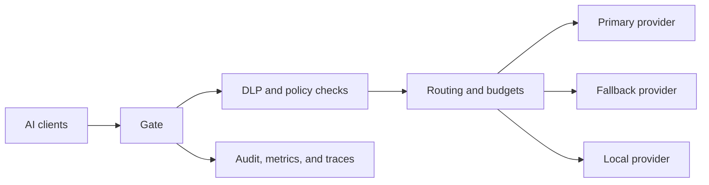

# Gate

> Route LLM traffic through one local gateway that protects secrets, controls
> spend, and fails over between providers.

[](https://github.com/murillo-consulting/gate/actions/workflows/ci.yml)
[](LICENSE)

Gate sits between AI coding tools and LLM providers. It normalizes Anthropic
and OpenAI requests, applies security and budget controls, then routes each
request to an ordered provider fallback chain.



## Quickstart

Prerequisites: Rust 1.88 or newer, a supported AI client, and credentials for at least
one provider.

```bash
cargo install --git https://github.com/murillo-consulting/gate --locked
gate setup
gate exec -- claude
```

`gate setup` writes the global configuration to
`~/.gate/config.toml`. `gate exec` starts the gateway when needed, exposes
the compatible API environment to the child process, and stops the gateway
after the child exits.

## What it does

- **Protects data before egress.** Inline DLP can redact or block secrets, PII,
  prompt-injection patterns, and suspicious exfiltration URLs.
- **Routes across providers.** Named logical models map to priority-ordered
  provider endpoints with retries, circuit breakers, and failover.
- **Controls usage.** Spend journals, tenant-aware virtual keys, rate limits,
  and monthly budgets constrain upstream calls.
- **Supports existing clients.** Anthropic Messages, OpenAI Chat Completions,
  and OpenAI Responses endpoints share one canonical request pipeline.
- **Produces operational evidence.** Signed audit records, Prometheus metrics,
  OpenTelemetry export, and the live `watch` view expose gateway activity.

## Configuration

Start with the interactive wizard. Provider secrets referenced as `$VARIABLE_NAME` are resolved from the environment at startup.

```bash
gate setup
```

| Setting | Purpose |
|---|---|
| `~/.gate/config.toml` | Global configuration |
| `.gate.toml` | Per-project overlay |
| `GATE_CONFIG` | Alternate local path or URL |
| `GATE_HOME` | Alternate state directory |
| `[::1]:13456` | Default local listener |

See the [configuration reference](docs/reference/configuration.md) and [provider guide](docs/how-to/providers.md) for provider definitions, model mappings, routing, budgets, and fallbacks.

## CLI

| Command | Purpose |
|---|---|
| `gate setup` | Create a configuration interactively |
| `gate start -d` | Start the gateway in the background |
| `gate stop` | Stop the background gateway |
| `gate exec -- <command>` | Run a client through Gate |
| `gate status` | Inspect health and current spend |
| `gate watch` | Open the live terminal dashboard |
| `gate preset list` | List embedded configuration presets |
| `gate doctor` | Check the local installation and configuration |

The full command surface is documented in the
[CLI reference](docs/reference/cli.md).

## Deployment

Container, Docker Compose, Podman Quadlet, Kubernetes, Helm, and the local observability demo live under [`deploy/`](deploy/). Follow the [deployment guide](docs/how-to/deploy.md) and review secrets, authentication, ingress, and persistence before using an example outside an isolated environment.

## Architecture

Requests enter the Axum server, are normalized into a canonical message model,
and pass through DLP, policy, cache, routing, provider dispatch, and spend
accounting stages. Provider adapters translate the canonical model to the
upstream wire format and translate streaming responses back to the client
format.

Read the [architecture guide](docs/explanation/architecture.md) and
[design decisions](docs/decisions/) before changing cross-cutting contracts.

## Development

### Prerequisites

- Rust 1.88 or newer
- A C toolchain required by the locked cryptography dependencies
- Optional deployment tools for their respective checks: Docker or Podman,
  Helm, and Kubernetes tooling

### Build and verify

```bash
cargo build
cargo test
cargo fmt --all -- --check
cargo clippy --all-targets --all-features -- -D warnings
```

The DLP fixtures under `tests/e2e/fixtures/dlp/` contain deliberately synthetic
credential- and PII-like values. They exist only to exercise detection rules;
do not replace them with live credentials or copy them into operational
configuration.

## Documentation

- [Getting started](docs/tutorials/getting-started.md)
- [Configuration reference](docs/reference/configuration.md)
- [API compatibility](docs/reference/api-compatibility.md)
- [Security model](docs/explanation/security.md)
- [DLP reference](docs/reference/dlp.md)
- [Operations guide](docs/reference/operations.md)
- [Deployment guide](docs/how-to/deploy.md)

## Contributing

Read [CONTRIBUTING.md](CONTRIBUTING.md) for the branch, test, review, and
Contributor License Agreement requirements. Security reports must follow
[SECURITY.md](SECURITY.md), not a public issue.

## License and attribution

Gate is licensed under the [Apache License 2.0](LICENSE). Commercial
offerings and the open-core boundary are described in
[LICENSING.md](LICENSING.md).

Copyright 2025-2026 Adrien Murillo.
